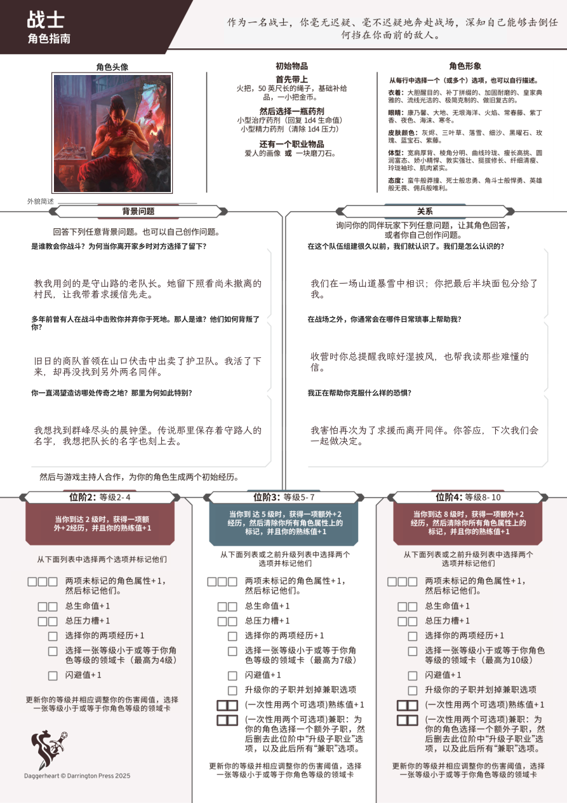
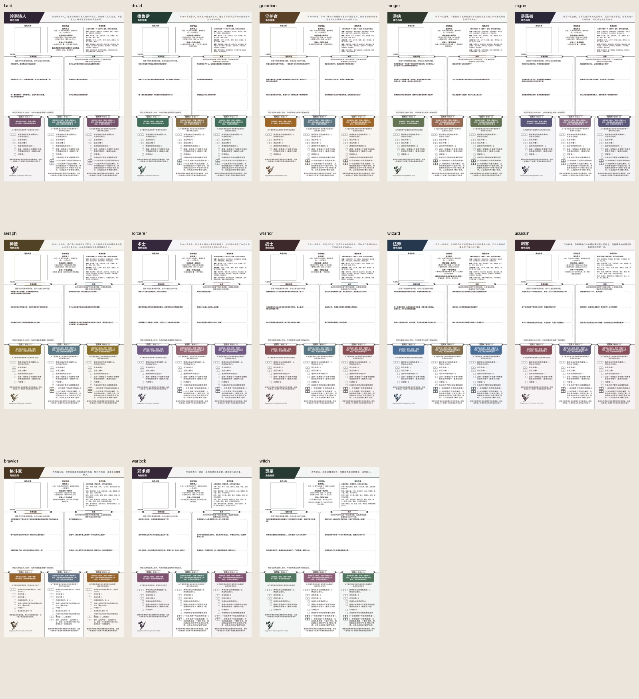

# 第二页左上角 · 45mm 正方形头像框

已将头像放到在线车卡器原版导出的第二页左上角，替代推荐初始属性／推荐装备。有头像时显示；无头像时沿用原版推荐区域。右侧角色形象、中间物品、背景、关系和升级区保留。上传照片沿用原有方形裁切工具。

头像不再单独附加到文末；长文字等真正需要的补充记录继续保留。彩色、黑白、离线 HTML 使用相同位置，现有存档格式不变。

## 13 职业空白模板

每职业一份 **A4 彩色空白打印 PDF，前后两页**，头像区固定留空，尺寸 45 × 45 mm。可手填、粘贴头像或用 PDF 编辑器插入图片；这套文件不带可填写表单。电子车卡与自动填值请使用在线车卡器。

- [下载 13 份独立 PDF 压缩包（约 23.4 MiB）](portrait-templates.zip?raw=true)
- [下载 26 页合集（含职业书签）](all-professions.pdf?raw=true)
- [使用说明](instructions.txt)

|职业|单独下载|
|---|---|
|吟游诗人|[PDF](pdf/bard.pdf?raw=true)|
|德鲁伊|[PDF](pdf/druid.pdf?raw=true)|
|守护者|[PDF](pdf/guardian.pdf?raw=true)|
|游侠|[PDF](pdf/ranger.pdf?raw=true)|
|游荡者|[PDF](pdf/rogue.pdf?raw=true)|
|神使|[PDF](pdf/seraph.pdf?raw=true)|
|术士|[PDF](pdf/sorcerer.pdf?raw=true)|
|战士|[PDF](pdf/warrior.pdf?raw=true)|
|法师|[PDF](pdf/wizard.pdf?raw=true)|
|刺客|[PDF](pdf/assassin.pdf?raw=true)|
|格斗家|[PDF](pdf/brawler.pdf?raw=true)|
|邪术师|[PDF](pdf/warlock.pdf?raw=true)|
|灵巫|[PDF](pdf/witch.pdf?raw=true)|

## 带头像的实际导出示例

## 空白模板总览

## 验证

- 35 项针对性测试通过；13 个职业均验证头像仅出现在第二页。
- 生产静态构建、TypeScript 检查及 41 个浏览器脚本的兼容语法检查通过。
- 实际浏览器导入已有带头像角色，验证彩色、黑白、离线 HTML 导出均为 3 页；头像不再产生单独一页。删除头像后原版推荐区域恢复。
- 13 份打印模板均为两页 A4，无示例人物或头像；第一页面内容流保留原版，右侧区域对比检查通过。合集共 26 页。
- 浏览器检查使用 Chromium，不等同于 Safari 实机验证。

原版版权标识保留；规则与原版美术归原权利人所有。头像示例采用原有利刃 6 级「久经沙场」卡牌插图，无生成插画。
