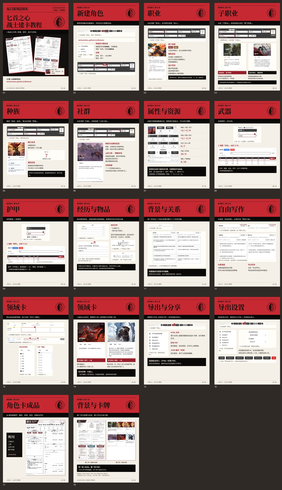

# 战士建卡教程 · 18图步骤版

1080×1440，按01–18发布。包含车卡器入口截图、位置红框、选择窗口及完成状态。

沿用上传的v5视觉风格与原始宝石，加大栏目标题。

- [下载18张发帖图与配文](https://github.com/AlchemiZhou/dhsheet/raw/refs/heads/codex/mixed-ancestry-test/testing/warrior-tutorial/warrior-tutorial-post.zip)
- [下载示例角色JSON与PDF](https://github.com/AlchemiZhou/dhsheet/raw/refs/heads/codex/mixed-ancestry-test/testing/warrior-tutorial/warrior-example.zip)
- [配文](caption.txt)

|页码|内容|图片|
|---|---|---|
|01|封面|[查看／保存](https://github.com/AlchemiZhou/dhsheet/raw/refs/heads/codex/mixed-ancestry-test/testing/warrior-tutorial/images/01.jpg)|
|02|新建角色|[查看／保存](https://github.com/AlchemiZhou/dhsheet/raw/refs/heads/codex/mixed-ancestry-test/testing/warrior-tutorial/images/02.jpg)|
|03|职业|[查看／保存](https://github.com/AlchemiZhou/dhsheet/raw/refs/heads/codex/mixed-ancestry-test/testing/warrior-tutorial/images/03.jpg)|
|04|子职业|[查看／保存](https://github.com/AlchemiZhou/dhsheet/raw/refs/heads/codex/mixed-ancestry-test/testing/warrior-tutorial/images/04.jpg)|
|05|种族|[查看／保存](https://github.com/AlchemiZhou/dhsheet/raw/refs/heads/codex/mixed-ancestry-test/testing/warrior-tutorial/images/05.jpg)|
|06|社群|[查看／保存](https://github.com/AlchemiZhou/dhsheet/raw/refs/heads/codex/mixed-ancestry-test/testing/warrior-tutorial/images/06.jpg)|
|07|属性与资源|[查看／保存](https://github.com/AlchemiZhou/dhsheet/raw/refs/heads/codex/mixed-ancestry-test/testing/warrior-tutorial/images/07.jpg)|
|08|武器|[查看／保存](https://github.com/AlchemiZhou/dhsheet/raw/refs/heads/codex/mixed-ancestry-test/testing/warrior-tutorial/images/08.jpg)|
|09|护甲|[查看／保存](https://github.com/AlchemiZhou/dhsheet/raw/refs/heads/codex/mixed-ancestry-test/testing/warrior-tutorial/images/09.jpg)|
|10|经历与物品|[查看／保存](https://github.com/AlchemiZhou/dhsheet/raw/refs/heads/codex/mixed-ancestry-test/testing/warrior-tutorial/images/10.jpg)|
|11|背景与关系|[查看／保存](https://github.com/AlchemiZhou/dhsheet/raw/refs/heads/codex/mixed-ancestry-test/testing/warrior-tutorial/images/11.jpg)|
|12|自由写作|[查看／保存](https://github.com/AlchemiZhou/dhsheet/raw/refs/heads/codex/mixed-ancestry-test/testing/warrior-tutorial/images/12.jpg)|
|13|领域卡筛选|[查看／保存](https://github.com/AlchemiZhou/dhsheet/raw/refs/heads/codex/mixed-ancestry-test/testing/warrior-tutorial/images/13.jpg)|
|14|领域卡选择|[查看／保存](https://github.com/AlchemiZhou/dhsheet/raw/refs/heads/codex/mixed-ancestry-test/testing/warrior-tutorial/images/14.jpg)|
|15|导出与分享|[查看／保存](https://github.com/AlchemiZhou/dhsheet/raw/refs/heads/codex/mixed-ancestry-test/testing/warrior-tutorial/images/15.jpg)|
|16|导出设置|[查看／保存](https://github.com/AlchemiZhou/dhsheet/raw/refs/heads/codex/mixed-ancestry-test/testing/warrior-tutorial/images/16.jpg)|
|17|角色卡成品|[查看／保存](https://github.com/AlchemiZhou/dhsheet/raw/refs/heads/codex/mixed-ancestry-test/testing/warrior-tutorial/images/17.jpg)|
|18|背景与卡牌|[查看／保存](https://github.com/AlchemiZhou/dhsheet/raw/refs/heads/codex/mixed-ancestry-test/testing/warrior-tutorial/images/18.jpg)|

示例角色数据和PDF保持原样。头像为原有利刃6级「久经沙场」插图，仅作头像，不加入1级卡组。原版开源车卡器：RidRisR。改造与教程：炼金术士阿刻米。规则与卡图归原创作者。
